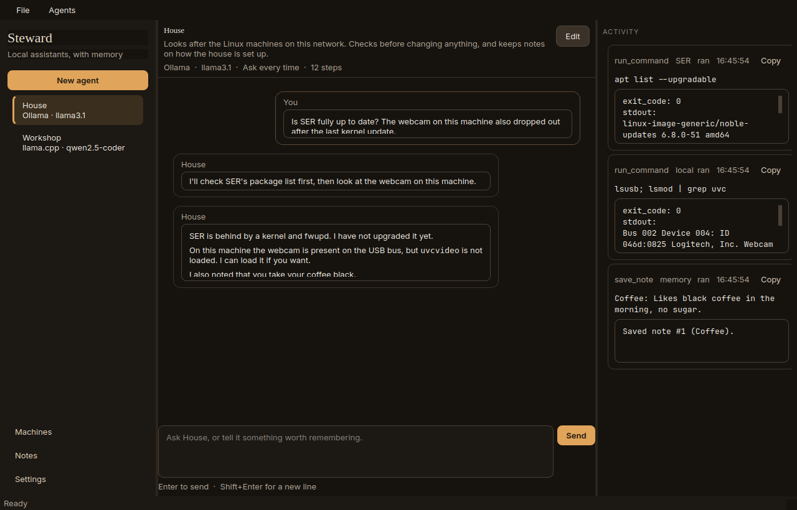

# Steward

Steward is a local, multi-agent personal assistant for Linux. Each agent has its own name, persona, model, and memory. It talks to **Ollama** or **llama.cpp** (`llama-server`) on your machine, and it can actually do the work: run a shell command, read a file, or SSH to another computer you have registered. A new install has no agents and no machines until you add them.

The desktop app and the terminal share one Python core, so a turn behaves the same way in both.



## Install

Python 3.11 or newer.

```bash
pipx install .
# or, from a clone:
python -m venv .venv
source .venv/bin/activate
pip install -e ".[dev]"
```

`pip install --user` puts `steward` and `steward-gui` in `~/.local/bin`. Add that directory to `PATH` if your shell does not already.

A normal desktop session already has the libraries Qt needs. If the window fails to open because `libEGL.so.1` is missing, install `libegl1`.

Optional launcher:

```bash
steward install-desktop
```

That copies a `.desktop` file and icon into your user applications directory.

## A model server

Steward does not download models. Point it at one you already run. URLs live in `~/.config/steward/config.toml` and can also be overridden with `STEWARD_OLLAMA_URL` and `STEWARD_LLAMA_CPP_URL`.

**Ollama** (default `http://127.0.0.1:11434`):

```bash
ollama serve
ollama pull <model>
steward models --backend ollama
```

**llama.cpp** `llama-server` (default `http://127.0.0.1:8080`, OpenAI-compatible `/v1`):

```bash
llama-server -m ~/models/your-model.gguf --host 127.0.0.1 --port 8080
steward models --backend llama_cpp
```

`steward doctor` prints the config path, the database path, and whether each server answers.

Models that support native tool calls are used that way. If a server rejects tools, or a model only writes them as text, Steward falls back to a small `<tool_call>{...}</tool_call>` protocol. Set an agent's tool protocol to `auto` (the default), `native`, or `text`.

## Quick start

```bash
steward agents create \
  --name <agent> \
  --backend ollama \
  --model <model> \
  --approval ask \
  --persona "<what this agent should look after>"

steward machines add <name> --local

steward machines add <other> \
  --host <host> \
  --user <user> \
  --identity-file ~/.ssh/id_ed25519 \
  --sudo-notes "Password required. The user is in the sudo group."

steward chat --agent <agent>
```

Then, in the chat:

```text
Is <other> fully up to date?
```

The agent will propose commands. Steward shows the exact command and the target machine and waits for `y` or `n`. A sudo password, if you type one, is passed to `sudo -S` on stdin for that turn and is not written to the database, the transcript, or the agent's notes.

One-shot, from another program or a keybinding:

```bash
steward ask --agent <agent> "The webcam stopped after the last kernel update. Find out why."
```

The window is the same assistant:

```bash
steward-gui
# or
steward gui
```

The sidebar is the list of agents. The transcript streams. The activity column is every tool call with its output. Machines, notes, and server URLs are in the buttons along the bottom of the sidebar.

## What an agent can do

| Tool | What it does |
| --- | --- |
| `run_command` | Bash on a saved machine: this computer, or another host over SSH |
| `read_file` | Read a text file on a saved machine |
| `write_file` | Replace a text file. Runs as the login user, not as root |
| `list_directory` | List a directory |
| `save_note` | Remember a fact. Same title updates the old note |
| `search_notes` | Keyword search over this agent's notes |
| `forget_note` | Delete one note by id or title |

Nothing is registered for you. Add this computer with `steward machines add <name> --local`, or tick **This computer** in the Machines window. Other machines are a name, host, user, port, optional identity file, and a note about how sudo works there. The password itself is never part of that note. With no machines saved, command and file tools are not offered, and Steward tells you the command above.

On the first turn that can use a machine, Steward reads each saved host once and caches a one-line summary: distro, package manager, whether that login is root, and whether `sudo` or `doas` is installed. Later turns reuse the cache. The probe is read-only and does not run `sudo`. `steward machines refresh` (or **Refresh facts** in the Machines window) reads them again. Changing a machine's host, user, or port drops its cache. Agents are prompted from that line: non-interactive package commands, `sudo` when the login is not root, a full upgrade (plus Flatpak or snap when those are installed) when asked to bring a machine up to date, and a look at devices and logs before changing anything.

On the first successful SSH connection Steward records the server host key. If that key changes later, Steward refuses to connect.

## Approval

Every agent has one of three modes:

| Mode | Behavior |
| --- | --- |
| `ask` | Ask before every action except saving or searching notes. This is the default. |
| `auto_readonly` | Run read-only commands, file reads, and directory listings on its own. Ask before anything that changes the machine. |
| `full_auto` | Run mutating commands on its own. |

Two things still stop for a person, in every mode:

- Commands Steward classifies as destructive (`rm -rf`, `mkfs`, `dd`, disk redirects, `curl | bash`, force-push, package removal, and similar).
- Anything that uses `sudo`, because the password has to come from you. In full-auto this is only the password prompt. The password is reused for later sudo commands in the same turn, then dropped. A rejected password is not reused.

If a command fails with a permission error, the tool result tells the agent to retry once with `sudo`. That retry still goes through approval. The password is still never written down.

The classifier is a heuristic, not a sandbox. The dialog shows the exact string that will run. Read-only detection understands common inspection commands (`ls`, `cat`, `df`, `systemctl status`, `git status`, `apt list`, pipelines of those, and so on). Anything it does not recognize is treated as a change.

## Memory

Each agent has its own SQLite notes. The system prompt for every turn includes the notes that match the user's message, filled out with a few recent notes when the wording does not overlap. The agent is instructed to call `save_note` when it learns a preference or a fact about a machine, and not to store secrets.

You can edit that memory yourself:

```bash
steward notes list --agent <agent>
steward notes add --agent <agent> --title Coffee --content "Black, in the morning."
steward notes search --agent <agent> coffee
steward notes edit 1 --agent <agent> --content "Black coffee, no sugar."
steward notes delete 1 --agent <agent>
```

The same list is in the window, under **Notes**. Conversation history is separate from notes. `steward agents clear-history <agent>` drops the transcript and the tool log and keeps the notes.

Keyword search is the implementation that ships. `memory.backend` in the config is the hook for a later embedding index (Ollama `/api/embeddings`). Unknown values stay on keywords.

## Layout

```text
steward/
  core/          agents, the tool loop, Ollama, llama.cpp, SSH, approval, SQLite
  cli/           Typer commands
  gui/           PySide6 window
```

Data lives in the XDG directories:

| Path | Contents |
| --- | --- |
| `~/.config/steward/config.toml` | Server URLs, timeouts, history length |
| `~/.local/share/steward/steward.db` | Agents, machines, transcripts, notes, tool log |

`STEWARD_CONFIG_DIR` and `STEWARD_DATA_DIR` override those locations.

## Adding a tool

Put a `Tool` subclass on the `steward.tools` entry-point group. Steward loads it next to the built-ins.

```toml
[project.entry-points."steward.tools"]
weather = "my_package.tools:WeatherTool"
```

```python
from steward.core.tools.base import Tool

class WeatherTool(Tool):
    name = "weather"
    description = "Local weather for a city."
    parameters = {
        "type": "object",
        "properties": {"city": {"type": "string"}},
        "required": ["city"],
    }
    approval_class = "read"  # safe | read | mutate

    def execute(self, arguments, context):
        return f"{arguments['city']}: 12°C"
```

`approval_class` chooses when Steward asks. `classify()` can still mark a particular call destructive, which always asks. Set `STEWARD_DISABLE_PLUGINS=1` to skip entry points.

## Tests

```bash
pip install -e ".[dev]"
pytest
```

The tests cover approval decisions, the SQLite store, local commands, SSH command construction with a stand-in client (the sudo password stays off the command string), the agent loop including denial and the step limit, both stream parsers, and a real HTTP conversation against a local stand-in for Ollama: the agent runs `echo`, saves a note, and sees that note in the next turn.

## Limits

- Destructive-command detection is deliberately cautious and will sometimes ask about a harmless line. It will also miss a destructive action hidden in a novel way. Read the command before you approve it.
- `doas` is recognized as privileged, but a password is only injected for `sudo`.
- File tools run as the login user. Writing a root-owned file means a `sudo` shell command, which goes through approval.
- There is no built-in machine. Until you add one, including this computer, the agent cannot run commands or read files.
- Very large command output is truncated before it is stored and sent back to the model.
- Stopping a turn kills a local process. A remote command is closed as soon as the SSH session drops, which is not always instant.
- There is no account system. Anyone who can run Steward as you can drive your machines, subject to the approval mode of the agent.
- Embedding search is not implemented yet. The `MemoryIndex` protocol in `steward/core/memory_index.py` is where it would go.

## License

MIT.
